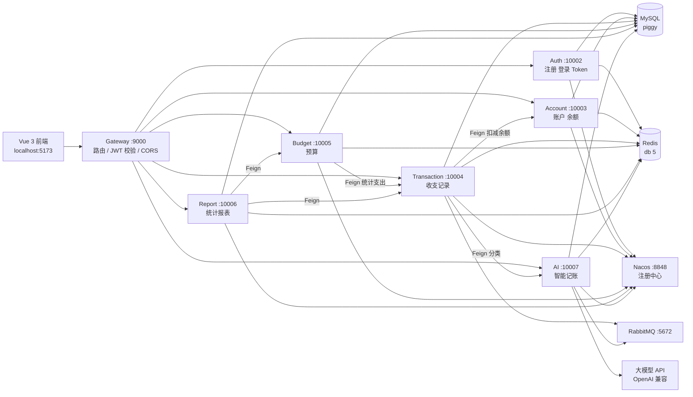

# PiggyMini

> 轻量级个人记账 / 理财微服务系统 —— 一个把 Spring Cloud Alibaba 全家桶 + AI 串起来的练手项目

参考 [PiggyMetrics](https://github.com/sqshq/piggymetrics) 的思路，用**微服务拆分**的方式重写一个「记账本」：账户、收支、预算、报表各自独立部署，通过网关统一入口，用 Nacos 做注册发现、OpenFeign 做服务间调用、RabbitMQ 做异步解耦，并接入大模型实现「一句话记账」。


---

## 目录

- [功能特性](#功能特性)
- [技术栈](#技术栈)
- [系统架构](#系统架构)
- [目录结构](#目录结构)
- [快速开始](#快速开始)
- [接口说明](#接口说明)
- [配置说明](#配置说明)
- [已知问题](#已知问题)
- [Roadmap](#roadmap)

---

## 功能特性

| 模块 | 能力 |
|---|---|
| 🔐 认证 | 注册、登录、JWT 双 Token（access + refresh）、退出登录、BCrypt 密码加密 |
| 💳 账户 | 多账户管理（现金 / 银行卡 / 支付宝）、余额维护、分页查询 |
| 🧾 收支 | 收支记录增删改查、按时间 / 类型 / 账户筛选、创建时联动扣减账户余额 |
| 📊 预算 | 月度分类预算、预算执行率、超支预警 |
| 📈 报表 | 收支总览、分类占比、预算执行率、收支趋势 |
| 🤖 AI 记账 | 自然语言解析流水（「早餐花了 15 元」→ 金额 / 分类 / 收支类型）、批量解析、消费分析报告、流式对话 |

前端提供登录注册、账户选择、仪表盘、收支 / 预算 / 报表 / AI 助手等页面。

---

## 技术栈

**后端**

| 分类 | 选型 |
|---|---|
| 语言 / 构建 | Java 17、Maven 多模块 |
| 基础框架 | Spring Boot 4.0.5 |
| 微服务 | Spring Cloud 2025.1.1、Spring Cloud Alibaba 2025.1.0.0（Nacos Discovery） |
| 网关 | Spring Cloud Gateway（WebFlux，响应式） |
| 服务调用 | OpenFeign + Fallback 降级 |
| 持久层 | MyBatis-Plus 3.5.15、MySQL 8.3（`mysql-connector-j`） |
| 缓存 | Redis（`spring-boot-starter-data-redis`，Lettuce 连接池） |
| 消息 | RabbitMQ（手动 ACK、死信队列） |
| 安全 | JJWT 0.12.5、BCrypt |
| 接口文档 | SpringDoc OpenAPI 2.6.0（Swagger UI） |
| AI | LangChain4j 1.13.0-beta23、Spring AI Alibaba 1.1.0.0（OpenAI 兼容协议） |
| 工具 | Lombok、Jakarta Validation |

**前端**

Vue 3.5 + Vite 8 + Vue Router 5 + Pinia 3 + Axios + Tailwind CSS 3

---

## 系统架构



### 服务与端口

| 服务 | 模块 | 端口 | 说明 |
|---|---|---|---|
| Gateway | `Piggy/Gateway` | **9000** | 唯一对外入口，统一路由到 `/api/**` |
| Auth | `Piggy/Auth` | 10002 | 认证授权 |
| Account | `Piggy/Account` | 10003 | 账户与余额 |
| Transaction | `Piggy/Transaction` | 10004 | 收支流水，含 MQ 消费者 |
| Budget | `Piggy/Budget` | 10005 | 预算 |
| Report | `Piggy/Report` | 10006 | 报表聚合 |
| AI | `Piggy/Ai` | 10007 | 大模型能力，仅内部调用 |
| Common | `Piggy/Common` | — | 公共依赖模块（无独立服务） |

### 鉴权链路

1. 前端登录后拿到 `token`，之后所有请求带 `Authorization: Bearer <token>`。
2. Gateway 的 `AuthGlobalFilter` 校验 JWT，放行 `/api/auth/**`。
3. 校验通过后，网关把用户身份写入请求头 `X-User-Id`，下游服务直接读取，**不再重复解析 Token**：

```java
public Result getAccounts(@RequestHeader("X-User-Id") Long userId) { ... }
```

> 因此绕过网关直连 10003 等服务时，必须手动带上 `X-User-Id` 请求头。

---

## 目录结构

```
PiggyMini_re/
├── Piggy/                        # 后端 Maven 多模块工程
│   ├── pom.xml                   # 父 POM：版本管理、公共依赖
│   ├── Common/                   # 公共模块
│   │   └── src/main/java/common/
│   │       ├── model/            # Result 统一响应、实体
│   │       ├── enums/            # 收支类型、账户类型、消费分类
│   │       ├── exception/        # 全局异常
│   │       ├── config/           # JWT / Redis / 全局异常处理
│   │       └── util/             # JWTUtil、BCryptUtil、RedisUtil、DateUtil
│   ├── Gateway/                  # 网关：路由 + AuthGlobalFilter + CORS
│   ├── Auth/                     # 认证服务
│   ├── Account/                  # 账户服务
│   ├── Transaction/              # 收支服务（Feign + RabbitMQ）
│   ├── Budget/                   # 预算服务
│   ├── Report/                   # 报表服务
│   └── Ai/                       # AI 服务（LangChain4j + 提示词模板）
├── fronted/Piggy-fronted/        # 前端 Vue 3 工程
│   ├── src/api/                  # 接口封装
│   ├── src/views/                # 页面
│   ├── src/stores/               # Pinia 状态
│   ├── src/router/               # 路由与守卫
│   └── src/utils/request.js      # Axios 实例 + Token 刷新
├── DataBase/                     # 建表脚本（Auth / Account / Transaction / Budget / Invest）
├── 接口文档说明/                  # 分模块接口文档
├── QS/                           # 环境准备笔记（Windows 安装 MySQL / Redis 等）
└── Piggy.md                      # 项目设计文档
```

---

## 快速开始

### 1. 环境要求

| 依赖 | 版本 |
|---|---|
| JDK | 17+ |
| Maven | 3.8+ |
| MySQL | 8.0+ |
| Redis | 6.0+ |
| Nacos | 2.x（默认 `127.0.0.1:8848`） |
| RabbitMQ | 3.12+ |
| Node.js | ^20.19.0 或 >=22.12.0 |

### 2. 初始化数据库

所有服务共用 `piggy` 库：

```bash
mysql -uroot -p -e "CREATE DATABASE IF NOT EXISTS piggy DEFAULT CHARSET utf8mb4 COLLATE utf8mb4_unicode_ci;"

mysql -uroot -p piggy < DataBase/Auth.sql
mysql -uroot -p piggy < DataBase/Account.sql
mysql -uroot -p piggy < DataBase/Transaction.sql
mysql -uroot -p piggy < DataBase/Budget.sql
# 可选：投资模块目前只有建表脚本，没有对应服务
mysql -uroot -p piggy < DataBase/Invest.sql
```

> Windows PowerShell 不支持 `<` 重定向，可用：
> `cmd /c "mysql -uroot -p piggy < DataBase\Auth.sql"`

### 3. 启动中间件

依次启动 **Nacos → MySQL → Redis → RabbitMQ**，并确认：

- Nacos 控制台可访问：<http://localhost:8848/nacos>
- RabbitMQ 管理台可访问：<http://localhost:15672>（默认 `guest/guest`）

### 4. 修改配置

各服务的 `src/main/resources/application.yml` 中默认连接本机中间件，**密码使用了带默认值的占位符**，建议通过环境变量覆盖：

```bash
# macOS / Linux
export MYSQL_PASSWORD=你的MySQL密码
export REDIS_PASSWORD=你的Redis密码
export NACOS_PASSWORD=你的Nacos密码

# Windows PowerShell
$env:MYSQL_PASSWORD="你的MySQL密码"
$env:REDIS_PASSWORD="你的Redis密码"
$env:NACOS_PASSWORD="你的Nacos密码"
```

AI 服务额外需要大模型配置（OpenAI 兼容接口）：

```bash
export OPENAI_API_KEY=sk-xxx
export OPENAI_BASE_URL=https://dashscope.aliyuncs.com/compatible-mode/v1
```

### 5. 启动后端

```bash
cd Piggy
mvn clean install -DskipTests
```

按依赖顺序启动（Gateway 最后启动也可以，但注册中心里没实例时会短暂 503）：

```bash
mvn -pl Auth        spring-boot:run
mvn -pl Account     spring-boot:run
mvn -pl Transaction spring-boot:run
mvn -pl Budget      spring-boot:run
mvn -pl Report      spring-boot:run
mvn -pl Ai          spring-boot:run
mvn -pl Gateway     spring-boot:run
```

或先打包再运行：

```bash
mvn clean package -DskipTests
java -jar Gateway/target/*.jar
```

启动完成后，Nacos 服务列表应出现 `Piggy-Gateway`、`Piggy-Auth`、`Piggy-Account`、`Piggy-Transaction`、`Piggy-Budget`、`Piggy-Report`、`Piggy-AI`。

### 6. 启动前端

```bash
cd fronted/Piggy-fronted
npm install
npm run dev
```

浏览器打开 <http://localhost:5173>。前端 Axios 的 `baseURL` 指向 `http://localhost:9000`（网关），请确保网关已启动。

### 7. 冒烟测试

```bash
# 注册
curl -X POST http://localhost:9000/api/auth/register \
  -H "Content-Type: application/json" \
  -d '{"username":"test001","password":"123456Ab","nickname":"测试用户"}'

# 登录，取 data.token
curl -X POST http://localhost:9000/api/auth/login \
  -H "Content-Type: application/json" \
  -d '{"username":"test001","password":"123456Ab"}'

# 带 Token 访问账户列表
curl http://localhost:9000/api/accounts?page=1&size=10 \
  -H "Authorization: Bearer <上一步的 token>"
```

---

## 接口说明

**统一入口**：`http://localhost:9000`，由 Gateway 按前缀路由。

**统一响应体**（`common.model.Result`）：

```json
{
  "code": 200,
  "message": "操作成功",
  "data": {},
  "success": true,
  "timestamp": 1744100000000
}
```

| code | 含义 |
|---|---|
| 200 | 成功 |
| 400 | 参数校验失败 |
| 401 | 未登录 / Token 失效 |
| 403 | 无权限 |
| 500 | 服务内部异常 |

### 各服务主要接口

| 服务 | 方法 | 路径 | 说明 |
|---|---|---|---|
| Auth | POST | `/api/auth/register` | 注册，用户名唯一，密码需字母+数字、6~20 位 |
| Auth | POST | `/api/auth/login` | 登录，返回 `token` / `refreshToken` |
| Auth | POST | `/api/auth/refresh` | 用 refreshToken 换新令牌 |
| Auth | POST | `/api/auth/logout` | 退出登录 |
| Account | POST | `/api/accounts` | 新增账户 |
| Account | GET | `/api/accounts?page=&size=` | 分页查询账户 |
| Account | GET | `/api/accounts/{id}` | 账户详情 |
| Account | PUT | `/api/accounts/{id}` | 更新账户 |
| Account | DELETE | `/api/accounts/{id}` | 删除账户 |
| Account | POST | `/api/accounts/balance` | **内部**：Transaction 调用，变更余额 |
| Transaction | POST | `/api/transactions` | 新增收支记录 |
| Transaction | GET | `/api/transactions` | 分页 + 条件查询 |
| Transaction | GET | `/api/transactions/{id}` | 记录详情 |
| Transaction | PUT | `/api/transactions/{id}` | 修改记录 |
| Transaction | DELETE | `/api/transactions/{id}` | 删除记录 |
| Transaction | POST | `/api/transactions/ai-classify` | AI 智能分类 |
| Transaction | GET | `/api/transactions/statistics/category-expense` | **内部**：分类支出统计 |
| Transaction | GET | `/api/transactions/statistics/category-income` | **内部**：分类收入统计 |
| Budget | POST | `/api/budgets` | 创建 / 更新月度预算 |
| Budget | GET | `/api/budgets/current` | 当月预算列表 |
| Budget | GET | `/api/budgets/warn` | 超支预警 |
| Report | GET | `/api/reports/summary?period=&date=` | 收支总览（`period=month\|year`） |
| Report | GET | `/api/reports/category?period=&date=` | 分类占比 |
| Report | GET | `/api/reports/budget-execution?month=` | 预算执行率 |
| Report | GET | `/api/reports/trend?startDate=&endDate=` | 收支趋势 |
| AI | POST | `/internal/ai/classify` | 单条流水分类 |
| AI | POST | `/internal/ai/batch-classify` | 批量解析（异步，返回 taskId） |
| AI | GET | `/internal/ai/batch-task/{taskId}/progress` | 批量任务进度 |
| AI | POST | `/internal/ai/query` | 自然语言查询账目 |
| AI | POST | `/internal/ai/analyze` | 生成消费分析报告 |
| AI | GET | `/internal/ai/chat/stream?message=` | SSE 流式对话 |
| AI | DELETE | `/internal/ai/chat/history` | 清除对话历史 |

> `/internal/**` 为服务间接口，网关虽有路由，但不建议前端直接调用。
> 更详细的字段级说明见 [`接口文档说明/`](接口文档说明) 与各服务启动后的 Swagger UI：`http://localhost:<port>/swagger-ui/index.html`。

---

## 配置说明

| 配置项 | 位置 | 默认值 |
|---|---|---|
| MySQL | 各服务 `application.yml` | `localhost:3306/piggy`，用户 `root` |
| Redis | 各服务 `application.yml` | `localhost:6379`，db `5` |
| Nacos | 各服务 `application.yml` | `127.0.0.1:8848`，namespace `public` |
| RabbitMQ | Transaction / Ai | `localhost:5672`，`guest/guest` |
| JWT 密钥 | Gateway `jwt.secret`、Common `JWTConfig` | 需保持一致 |
| 大模型 | Ai `langchain4j.open-ai.chat-model` | `qwen3-omni-flash` |
| 对话记忆 | Ai `ai.memory.max-messages` | 10 条 |

---

## 已知问题

这些是当前代码里真实存在、后续需要收拾的地方（欢迎 PR）：

1. **敏感信息硬编码**：`application.yml` 中写有数据库 / Redis / Nacos 的默认密码，`jwt.secret` 也是明文。建议全部改为纯占位符并配合 `.env` 或 Nacos 配置中心。
2. **占位符命名冲突**：Redis 用 `${password:...}`，Nacos 用 `${PASSWORD:...}`，在 Windows 上环境变量大小写不敏感，会互相覆盖，建议统一前缀为 `REDIS_PASSWORD` / `NACOS_PASSWORD`。
3. **构建产物入库**：`Piggy/Common/target/`、`.idea/` 被提交到了仓库，`.gitignore` 需补充 `target/`、`.idea/`、`*.iml`。
4. **前端刷新 Token 地址写死**：`src/utils/request.js` 中刷新请求指向 `http://localhost:8080`，与网关端口 `9000` 不一致，应统一走 `baseURL`。
5. **设计文档与实现有偏差**：`Piggy.md` 写的是 Spring Boot 3.x、Knife4j、六个独立库、Invest 服务；实际是 Spring Boot 4.x、SpringDoc、单库 `piggy`，Invest 仅有建表脚本和实体，没有独立服务。
6. **前后端代码风格不统一**：`src/api/` 下 `.js` 与 `.ts` 文件并存（`auth.js` / `auth.ts` 等），建议统一到 TypeScript。
7. **测试覆盖不足**：仅有少量工具类与接口测试（`AccountTest`、`UserTest`、`BCryptUtilTest`、`JWTUtilTest`），业务逻辑缺少单元测试。

---

## Roadmap

- [ ] 用 `docker-compose` 一键拉起 MySQL / Redis / Nacos / RabbitMQ 及全部服务
- [ ] 补齐 Invest 投资模块（持仓、收益计算）
- [ ] 引入 Sentinel 熔断降级（配置项已预留，未接 Dashboard）
- [ ] 接入 Prometheus + Grafana 监控，暴露 `/actuator/prometheus`
- [ ] 单元测试覆盖核心业务（目标 60%+）
- [ ] 前端统一 TypeScript，抽离重复的 API 封装
- [ ] GitHub Actions：编译 + 测试 + 镜像构建
- [ ] 部署到 Minikube，补 K8s manifests

---

## 说明

本项目为个人学习练手项目，用于实践微服务拆分、服务治理、分布式中间件与 AI 应用集成，**未做生产级加固**（无限流、无审计、无多租户隔离），请勿直接用于生产环境。

设计文档见 [`Piggy.md`](Piggy.md)，分模块接口文档见 [`接口文档说明/`](接口文档说明)，环境准备笔记见 [`QS/`](QS)。

## License

MIT
